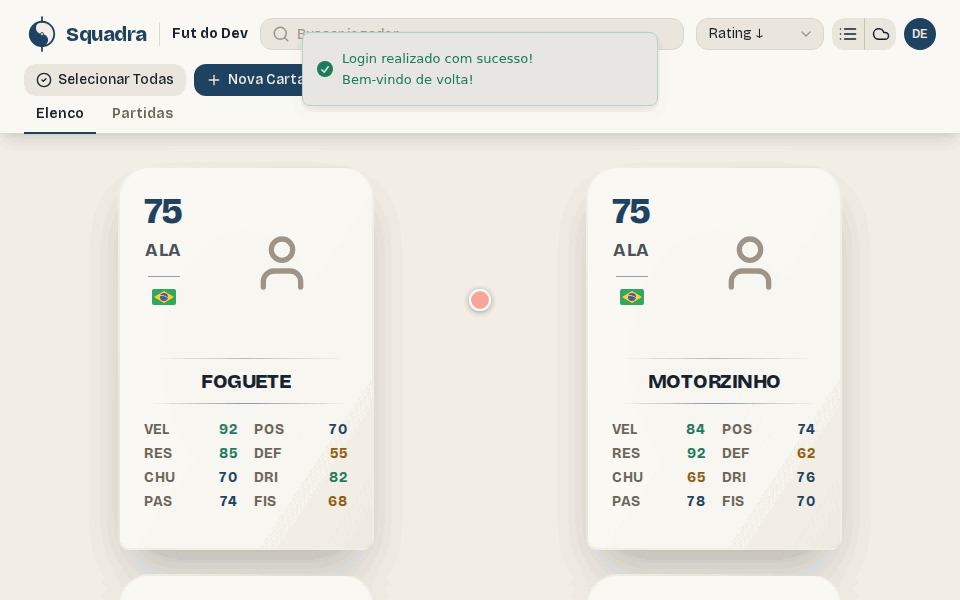
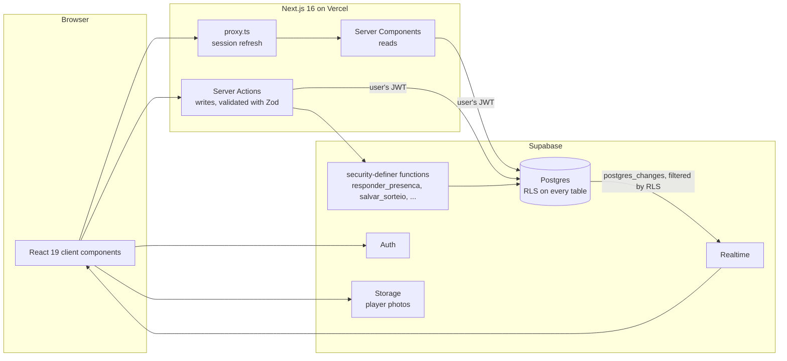
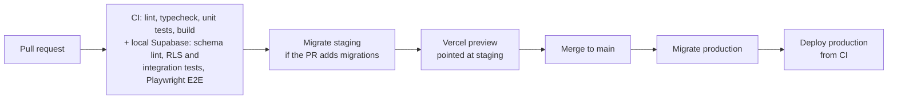

# Squadra

[](https://github.com/dev-nilo/nextjs-squadra/actions/workflows/ci.yml)


Squadra runs a weekly pickup-football game, a *pelada*. It keeps the group's roster, opens each game with a fixed number of spots, lets people say they're in or out while the list updates live, keeps a first-in, first-out waitlist, and draws balanced teams on the server.

**Live:** [squadra-eight.vercel.app](https://squadra-eight.vercel.app). Signing up needs email confirmation. The UI is in Portuguese, and this README explains the domain terms.



## What's in it

- **A multi-tenant Postgres database.** Every table is behind row-level security, with three roles (`dono`, `admin`, `membro`). Integration tests sign in as each role and check every rule.
- **A race-safe last spot.** Saying "I'm in" is one Postgres function that takes a row lock. When eight people tap at once for one spot, exactly one gets it, and the rest join the waitlist in the order they asked.
- **A live presence list.** Supabase Realtime pushes changes, and every subscriber sees them under their own RLS.
- **A server-side team draw.** Each player's rating is copied into the saved draw at draw time, so editing a player later doesn't rewrite past games.
- **A zero-downtime schema change.** Moving from per-user rosters to shared groups took four expand/contract steps, one migration and one deploy each.
- **A delivery pipeline.** Every PR runs against a throwaway local database in CI, migrates staging and gets a preview. Merging to `main` migrates production first, and only then deploys the app.

## Architecture



- **Reads** happen in Server Components, as the signed-in user, so RLS decides what each person sees.
- **Writes** go through Server Actions, which validate input with Zod and map database refusals to messages.
- **Rules that need a transaction** live in Postgres functions: claiming a spot, saving or publishing a draw, accepting an invite. These functions report why they refused in the error's `HINT` (`lista-mudou`, `sem-permissao`, ...), and the app branches on that, not on error text.
- **RLS is the last line of defense.** Even a hand-crafted request with a valid token can't read another group's data or write a role it doesn't have.



## Interesting problems

### Two people, one spot left

A game has, say, 14 spots. When the 14th and 15th person tap "Vou" at the same moment, one has to get the spot and the other has to join the waitlist. Neither can be lost, and nobody can end up confirmed twice.

[`responder_presenca`](supabase/migrations/20261110234500_partidas.sql) takes the game's row lock (`SELECT … FOR UPDATE`) before counting, so overlapping calls queue up in Postgres. Each call stamps its request with `clock_timestamp()` *after* taking the lock, so the waitlist order is the order the answers were actually applied. When someone drops out, the first in line is promoted in the same transaction.

[The test](tests/integration/partidas.test.ts) fires eight separate clients at one free spot. It checks four things:

- exactly one is confirmed;
- the other seven wait, with no tied timestamps;
- what each call returned matches what was stored;
- the line moves in that order.

PR [#50](https://github.com/dev-nilo/nextjs-squadra/pull/50).

### Roles enforced by the database, and tested

- **No recursive policies.** Every policy asks a single `security definer` helper, `papel_no_grupo()`, for the caller's role, so no policy has to query the membership table it protects.
- **Column-level grants.** They keep fields like a player's author out of reach even for people allowed to edit the row.
- **Realtime under the same rules.** Realtime subscriptions respect the same policies, so a live list never leaks another group's changes.

The [integration tests](tests/integration) sign in as an owner, an admin, a member and an outsider, and check each row of the permission table. That includes the outsider getting an empty result rather than an error. [ADR 0003](docs/adr/0003-elenco-belongs-to-a-grupo.md), PRs [#43](https://github.com/dev-nilo/nextjs-squadra/pull/43) and [#45](https://github.com/dev-nilo/nextjs-squadra/pull/45).

### Changing who owns the data, without downtime

Rosters started out per user. They had to become per group, with roles, while real data and a deployed app stayed up. The change went out as expand/contract, one PR with one migration and one deploy per step. Each step was rehearsed on staging first:

1. **Expand** ([#36](https://github.com/dev-nilo/nextjs-squadra/pull/36)): add groups next to the old model.
2. **Switch reads and writes** ([#41](https://github.com/dev-nilo/nextjs-squadra/pull/41)).
3. **Enforce** ([#43](https://github.com/dev-nilo/nextjs-squadra/pull/43)): give every row a group and make it `NOT NULL`. Orphaned rows were adopted into a group, not deleted, after the owner checked the count.
4. **Contract** ([#45](https://github.com/dev-nilo/nextjs-squadra/pull/45)): drop the per-user policies and columns.

At every step, the deploy before it kept working against the new schema.

### History that doesn't rewrite itself

A published draw copies each player's rating into the draw itself, so a later edit doesn't change old games ([ADR 0004](docs/adr/0004-sorteio-snapshots-ratings.md)).

That copy is built *inside* [`salvar_sorteio`](supabase/migrations/20261111200000_sorteios.sql), from the players table. The table is read-only to the API, so no client, not even an admin's, can save a made-up rating.

A draw must contain exactly the confirmed players, never the waitlist. Publishing is refused if the confirmed list changed since the draw. PR [#53](https://github.com/dev-nilo/nextjs-squadra/pull/53).

Attendance, in turn, is a `security_invoker` view, `frequencia_jogadores`, so it runs under the caller's RLS like any table ([#54](https://github.com/dev-nilo/nextjs-squadra/pull/54)).

### Migrations before code

- **Production order.** Vercel's own Git deploy is off for `main` ([`vercel.json`](vercel.json)). CI pushes the migrations to production, and only then deploys the app, so new code never goes live before the schema it needs. If a migration fails, the previous deploy keeps serving.
- **Pull requests.** Every PR runs the whole stack in CI: a local Supabase started from the migrations and a deterministic seed, the RLS and integration tests, and Playwright against a production build. Tests never touch staging or production.
- **Staging.** A PR that adds migrations pushes them to staging, and its Vercel preview runs against them. A PR without migrations skips that step, so it doesn't trip over another open PR's migration.

[`ci.yml`](.github/workflows/ci.yml), [`docs/staging.md`](docs/staging.md), PRs [#31](https://github.com/dev-nilo/nextjs-squadra/pull/31), [#37](https://github.com/dev-nilo/nextjs-squadra/pull/37), [#42](https://github.com/dev-nilo/nextjs-squadra/pull/42) and [#47](https://github.com/dev-nilo/nextjs-squadra/pull/47).

## Stack

| | |
| --- | --- |
| App | Next.js 16 (App Router, Server Components, Server Actions), React 19, TypeScript, Tailwind CSS, Zod |
| Data | Supabase: Postgres with RLS, plpgsql functions, Realtime, Auth, Storage; Supabase CLI migrations |
| Tests | Vitest (unit, plus integration against a local Supabase), Playwright (E2E) |
| Delivery | GitHub Actions, Vercel (previews against staging, production deployed from CI), Sentry tagged by environment |

## Running it locally

You need Node (version in [`.nvmrc`](.nvmrc)) and Docker.

```bash
npm ci
npm run db:start        # local Supabase: applies every migration and supabase/seed.sql
```

Copy the API URL and anon key it prints into `.env.local`:

```bash
NEXT_PUBLIC_SUPABASE_URL=http://127.0.0.1:54321
NEXT_PUBLIC_SUPABASE_ANON_KEY=...
```

Then run `npm run dev` and open http://localhost:3000. The seed users all use the password `squadra-dev-123`:

- `dev@squadra.test` owns "Fut do Dev": 20 players, an upcoming game and four past ones.
- `amigo@squadra.test` owns another group, for checking that groups never see each other.
- `novato@squadra.test` has no group yet, so signing in goes to the "name your game" screen.

| Command | |
| --- | --- |
| `npm test` | Unit tests |
| `npm run test:integration` | RLS and database tests. Set `SUPABASE_URL`, `SUPABASE_ANON_KEY` and `SUPABASE_SERVICE_ROLE_KEY` from `npx supabase status` |
| `npm run test:e2e` | Playwright against `next start` and the local database (run `npm run build` first) |
| `npm run lint` / `npm run typecheck` | |
| `npm run db:reset` | Rebuild the local database from migrations and seed |

Schema changes are always a new migration (`npx supabase migration new <name>`), never SQL run by hand on a dashboard.

## Glossary

The code keeps the domain in Portuguese, the way the people using it talk. The main terms:

| Term | Meaning |
| --- | --- |
| **Grupo** | The group that plays together. It owns the roster |
| **Membro** | A user in a Grupo, with a role: `dono` (owner), `admin` or `membro` |
| **Jogador** | A player card: position, attributes, overall rating (OVR) |
| **Elenco** | A Grupo's roster, all its Jogadores |
| **Partida** | One game: date, place, number of spots (*vagas*) |
| **Presença** | A Jogador's answer to a Partida: *vou* (in) or *não vou* (out) |
| **Lista de espera** | The waitlist, first in, first out |
| **Sorteio** / **Time** | The team draw, and one of the teams it produces |
| **Frequência** | Attendance rate over the last 10 Partidas |
| **Convite** | An invite link to join a Grupo |

The full glossary is in [`CONTEXT.md`](CONTEXT.md), and the design decisions are in [`docs/adr`](docs/adr).

## Not in scope

These were left out on purpose: notifications, payments, players rating each other, a native mobile app, UI translations (the UI is Portuguese only), match scores, and email invites (invites are links).

## More docs

- [`docs/staging.md`](docs/staging.md): environments, secrets, and how migrations reach each one.
- [`docs/auth-email.md`](docs/auth-email.md): Supabase Auth URLs and the confirmation email template.
- [`DESIGN.md`](DESIGN.md): UI and design decisions.
- [`AGENTS.md`](AGENTS.md): how AI agents work in this repo.
