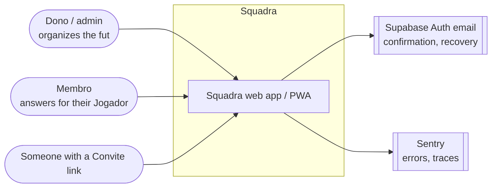
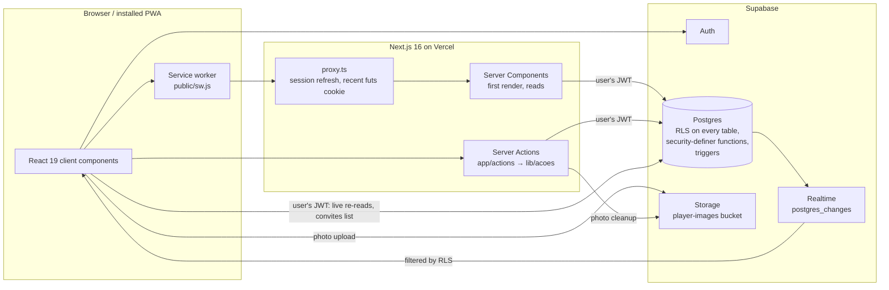
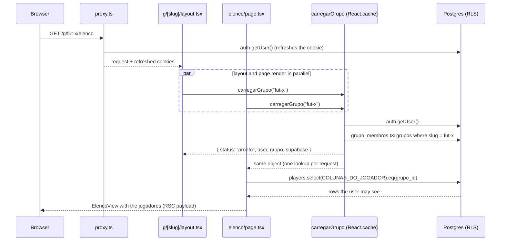
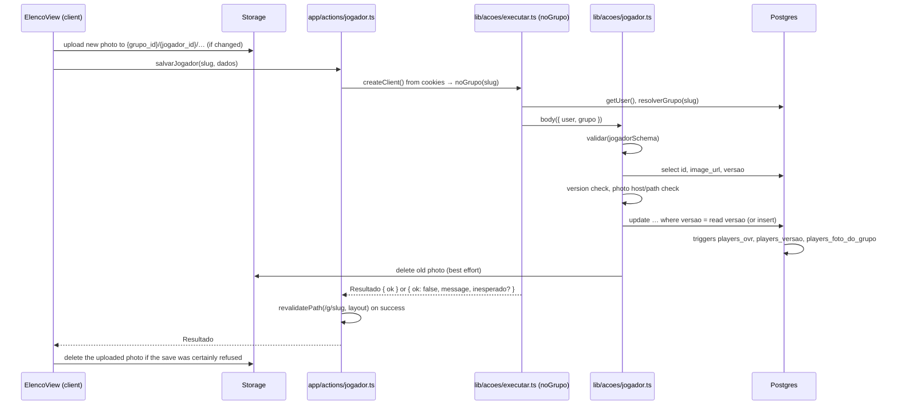
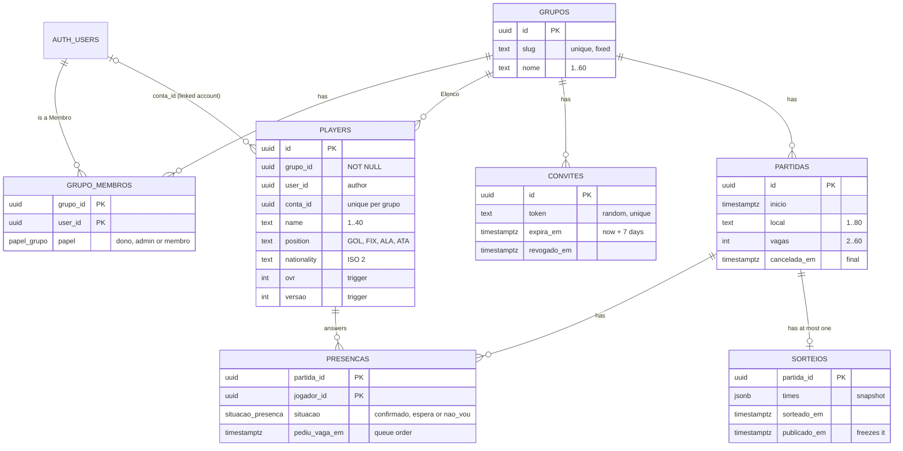
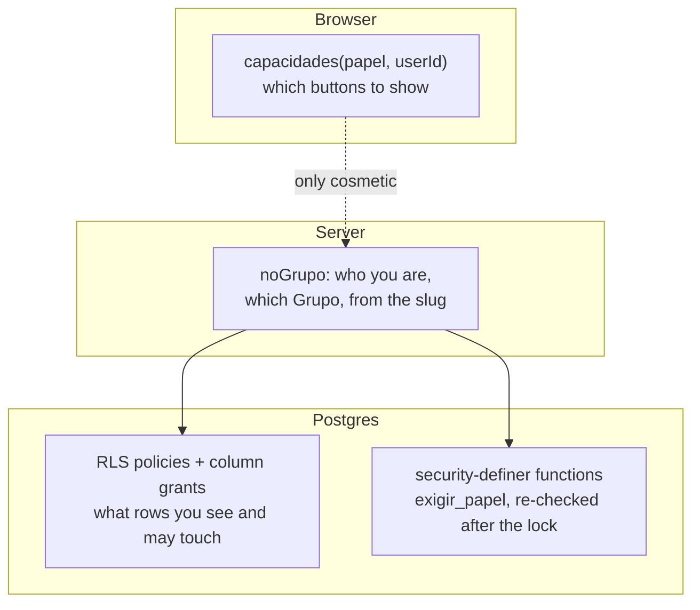
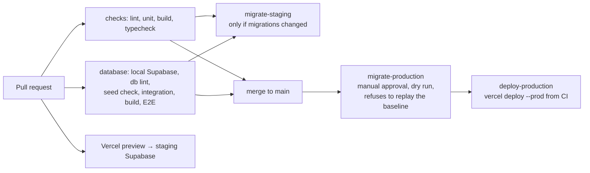
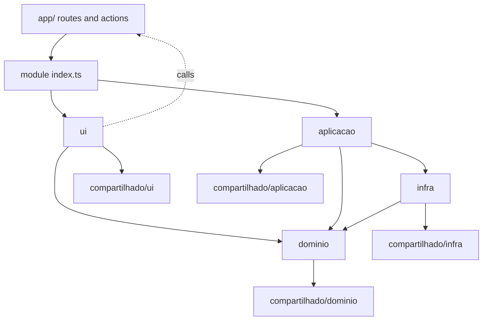

# Architecture

How Squadra is built today, and the structure the rewrite is moving it to. Part 1 describes the code as it is on `main`. Part 2 is the target agreed on 2026-11-27 (milestones M0 to M8). Once the rewrite is done, Part 1 is deleted and Part 2 becomes the description of the system.

Domain words (Grupo, Jogador, Partida, Sorteio, papel…) are defined in [`CONTEXT.md`](../CONTEXT.md). Decisions and their reasons are in [`docs/adr/`](adr/).

---

# Part 1: As-is

## 1. Context

Squadra organizes a weekly pickup football game (a "pelada"): the people in a Grupo, their Elenco of Jogadores, each Partida's list of who's going, and a balanced Sorteio of Times.



There is one product surface, a mobile-first web app that installs as a PWA. The UI is Portuguese-only.

## 2. Containers



- **Every database call runs as the signed-in user.** The server never uses the service role key. Row Level Security decides what each query sees, and security-definer functions decide what each write may do. No container holds a privileged credential.
- **Next.js** renders the first view on the server (Server Components) and takes every write through Server Actions. There are no route handlers (`route.ts`).
- **`proxy.ts`** (Next 16's name for middleware) runs on `/` and `/g/*`. It refreshes the Supabase session cookie with `getUser()` and remembers the recently opened Grupos in the `squadra-futs` cookie, which `/` uses to pick where to send you ([proxy.ts:15](../proxy.ts#L15)).
- **The service worker** keeps a network-first copy of the pages you opened, so the app opens read-only without signal ([public/sw.js](../public/sw.js), ADR 0006 amendment). Offline, the UI swaps in `SO_LEITURA` capacities ([lib/capacidades.ts:65](../lib/capacidades.ts#L65)).
- **Sentry** receives unexpected errors from the action seam ([lib/acoes/executar.ts:133](../lib/acoes/executar.ts#L133)) and from `onRequestError` ([instrumentation.ts](../instrumentation.ts)). No PII is sent ([lib/sentry-options.ts](../lib/sentry-options.ts)).

## 3. Code layout today

There is no `src/`. The layers exist by convention, not by folder:

| Folder | Holds | Layer it plays |
|---|---|---|
| `app/` | Routes, layouts, `app/actions/*` (7 `"use server"` files) | Delivery: routing and Server Action adapters |
| `lib/acoes/` | The bodies of every mutation, behind `executar.ts` | Application (use cases) |
| `lib/*.ts` (`partida`, `sorteio`, `sorteio-partida`, `jogador`, `grupo`, `capacidades`, `pessoas`, `vinculo`, `convite`, `navegacao`, `csv-import`) | Pure TypeScript rules, Zod schemas, row mappers | Domain (some mappers are infrastructure) |
| `lib/leitura-da-partida.ts` | The Partida read model, used by server and browser | Read side |
| `lib/grupo-server.ts`, `lib/supabase/*`, `lib/player-image.ts`, `lib/sentry-options.ts`, `lib/pwa/*` | Clients, Grupo resolution, Storage, PWA helpers | Infrastructure |
| `lib/sessao.ts` | Env config, all auth flows, redirect safety, error decoding, toast copy | All four (see debts) |
| `components/` | UI by feature, plus hand-made primitives in `components/ui/` | UI |
| `hooks/` | `use-auth`, `use-partida-ao-vivo`, `use-sorteio-rapido`, `use-foco-ao-mover` | UI state |
| `types/index.ts` | `Player`, `Attributes`, `Time`, `PlayerPosition` | Domain types (English names) |
| `supabase/` | 28 migrations, seed, email templates, config | The database, where most rules live |
| `tests/integration/`, `e2e/` | Vitest against a real local Supabase; Playwright | Safety net |

### Routes

| Route | What it is |
|---|---|
| `/` | Server Component: no session → first access; otherwise redirect to a recent Grupo |
| `/auth`, `/auth/callback`, `/auth/confirm`, `/auth/nova-senha` | Sign-in, sign-up, email confirmation, password recovery (client, on `lib/sessao.ts`) |
| `/convite/[token]` | Reads a Convite with `ver_convite`, works signed out |
| `/g/[slug]` (layout) | Gate: `carregarGrupo` decides sign-in / not found / ready, then the shell with three tabs |
| `/g/[slug]` | The next Partida, or the history |
| `/g/[slug]/partidas`, `/partidas/[id]` | History with Frequência; one Partida, live |
| `/g/[slug]/elenco` | The Elenco, the carta editor, the quick Sorteio |
| `/g/[slug]/pessoas` | Membros, papéis, Convites |
| `/g/[slug]/voce` | Your Jogador, your Grupos, account |

## 4. How a read works: the Elenco page



1. [proxy.ts:34](../proxy.ts#L34) refreshes the session.
2. The layout calls `carregarGrupo(slug)` ([lib/grupo-server.ts:27](../lib/grupo-server.ts#L27)). It is wrapped in `React.cache`, so the layout and the page share one lookup. It returns a status union: `sem-sessao`, `nao-encontrado` or `pronto` with the user, their papel and the client.
3. `resolverGrupo` ([lib/grupo-server.ts:45](../lib/grupo-server.ts#L45)) joins `grupo_membros` and `grupos` by slug. RLS only returns Grupos you belong to, so someone else's slug reads exactly like a slug that doesn't exist.
4. The page queries `players` inline ([app/g/[slug]/elenco/page.tsx:17](../app/g/%5Bslug%5D/elenco/page.tsx#L17)), and maps the rows with `jogadorDaLinha` ([lib/jogador.ts:60](../lib/jogador.ts#L60)). The client is typed with the generated `Database`, so the rows already have their columns' types.

The Partida pages go through a read model instead, `lib/leitura-da-partida.ts`. The Elenco, Você and Pessoas pages query inline, which Part 2 removes.

**Live updates.** A Partida page subscribes to `postgres_changes` on `presencas`, `sorteios` and `partidas`, filtered by that Partida ([hooks/use-partida-ao-vivo.ts:46](../hooks/use-partida-ao-vivo.ts#L46)). Any event triggers a full re-read through `lerPartidaAoVivo` ([lib/leitura-da-partida.ts:53](../lib/leitura-da-partida.ts#L53)), still under the user's RLS. The event is only a signal; its payload isn't trusted. The publication sends inserts and updates only, because Realtime can't filter deletes by RLS (#83). A delete of presenças touches the Partida row instead, so subscribers still hear about it.

## 5. How a write works: saving a Jogador



- The adapter is two lines ([app/actions/jogador.ts:9](../app/actions/jogador.ts#L9)): build the client from cookies, call `lib/acoes`, revalidate (ADR 0007).
- The seam `noGrupo` ([lib/acoes/executar.ts:108](../lib/acoes/executar.ts#L108)) validates the slug, gets the user, resolves the Grupo from the slug (never from an id the browser sent) and runs the body.
- Inside a body, refusals are thrown (`recusar`, `validar`, `exigir`, `exigirLinhas`). The seam catches everything and runs one error table, `traduzir` ([lib/acoes/executar.ts:124](../lib/acoes/executar.ts#L124)): an expired session, a known HINT or Postgres code from the action's `motivos`, an RLS refusal, or "unexpected", which goes to Sentry with `inesperado: true` because nobody knows whether the write happened. Nothing thrown crosses the seam. Callers always get a `Resultado`.
- Optimistic concurrency: the body compares the `versao` it read with the one sent, and the update filters on it ([lib/acoes/jogador.ts:72](../lib/acoes/jogador.ts#L72), [:88](../lib/acoes/jogador.ts#L88)). The trigger `players_versao` bumps it on every write. Two tabs editing one carta can't silently overwrite each other (#89).
- The client deletes its own upload only when the refusal is certain (`!resultado.inesperado`, [components/elenco/elenco-view.tsx:136](../components/elenco/elenco-view.tsx#L136)).

Writes that need a transaction call a database function instead of a table write: `responder_presenca`, `salvar_sorteio`, `mover_no_sorteio`, `publicar_sorteio`, `excluir_jogador`, `vincular_jogador`, `aceitar_convite`, `criar_grupo`, and the people functions of ADR 0008.

## 6. Data model



Plus: the view `frequencia_jogadores` (security invoker, so it runs under the caller's RLS); the public Storage bucket `player-images`, foldered by `grupo_id`; Realtime on `partidas`, `presencas` and `sorteios`.

The schema reached this shape through expand/contract while production was live. Jogadores first belonged to a user, and were moved to a Grupo in five steps (ADR 0003). To read a function's current body, read the **last** migration that redefines it (most were rewritten in `20261124000000_ordem_dos_locks.sql` and `20261125000000_ordem_ao_excluir_e_vincular.sql`).

## 7. Authorization (RBAC)

Three fixed papéis per Grupo: **dono** (exactly one), **admin**, **membro**.



- **The database is the authority.** RLS is forced on every table and `anon` has no table access; the only thing callable signed out is `ver_convite`, so a Convite link can show which Grupo it opens. Tables that change people (`grupos`, `grupo_membros`) have no write grants at all: every change goes through a function (ADR 0008). `players` has column-level update grants, so `id`, `grupo_id`, `user_id`, `conta_id` and `versao` can't be written directly.
- **`papel_no_grupo(grupo)`** is the helper every policy and function uses. It is `security definer` so policies on `grupo_membros` don't recurse into themselves.
- **Every security-definer function** sets `search_path = ''` and schema-qualifies every name, so a caller can't shadow a table or function.
- **TypeScript checks no papéis**, with one exception: `excluirFut` refuses a non-dono before deleting Storage files, because that can't be undone, and `excluir_grupo` checks again (ADR 0007).
- **`capacidades()`** only decides what the UI shows. An integration test checks its answers against what the database really allows ([tests/integration/pessoas.test.ts](../tests/integration/pessoas.test.ts)).

## 8. Concurrency

| Race | How it's handled | Where |
|---|---|---|
| Two people take the last vaga | `responder_presenca` locks the Partida row (`for update`), counts confirmados and inserts in one transaction. Queue order is `clock_timestamp()`, the real time of the statement rather than of the transaction | [20261125000000_ordem_ao_excluir_e_vincular.sql](../supabase/migrations/20261125000000_ordem_ao_excluir_e_vincular.sql) |
| A vaga frees up | `promover_espera` promotes the first in the lista de espera in the same transaction. It runs on "não vou", when vagas go up, and when a confirmed Jogador is deleted | same, and `partidas_promove_depois`, `presencas_promove_ao_excluir` |
| Deadlocks between functions | One lock order everywhere: the `grupos` row first, then Partidas in id order, then the Jogador. The papel is re-checked after the lock, since it may have changed while waiting (#86, #91, #108) | `20261124000000_ordem_dos_locks.sql` |
| Answer vs delete of the same Jogador | An advisory lock per Jogador: shared in `responder_presenca`, exclusive in `excluir_jogador` (#108) | migration 26 |
| Two admins move Jogadores in a draft Sorteio | `mover_no_sorteio` under the Partida lock, with an optimistic `sorteado_em` check (`sorteio-mudou`) | `20261112180000_mover_no_sorteio.sql` |
| Two tabs edit one carta | `versao` compare-and-update | §5 |
| Creating a 6th Grupo from two tabs | Advisory lock per account in `criar_grupo` | `20261124030000_slug_e_limite_de_grupos.sql` |

`tests/integration/ordem-dos-locks.test.ts` runs these races with two real connections.

## 9. Where each invariant is enforced

| Invariant | Database | TypeScript | UI only |
|---|---|---|---|
| Exactly one dono | partial unique index; no write grants; `passar_posse`, `sair_do_grupo` (`dono-nao-sai`) | `papelDadoSchema` excludes dono | |
| Only the dono manages people and the Grupo | the six people functions + `exigir_papel` | `excluirFut` pre-check | `gerePessoas`, `gereFut` |
| 5 Grupos per account (on create) | `criar_grupo`, count under an advisory lock | | |
| Slug fixed and valid | CHECK, unique, no update grant | `slugSchema` | |
| One Jogador per account per Grupo | partial unique index; `vincular_jogador`, `criar_meu_jogador` | maps 23505 | |
| Jogador field rules (name, position, nationality, attributes 0..99) | CHECKs | `jogadorSchema`, `meuJogadorSchema` | |
| OVR = rounded mean of the attributes | trigger `players_ovr` | `calculateOVR`, preview only | |
| Photo is a file in the Grupo's folder | Storage policies; trigger `players_foto_do_grupo` | `ehFotoDoGrupo` (URL host) | |
| A stale carta save is refused | trigger bumps `versao` | compare-and-update in `salvarJogador` | |
| Cancelling a Partida is final | trigger `partidas_cancelada_e_final`; functions refuse `cancelada` | | `respondePor` |
| Vagas never below confirmados | trigger `partidas_confere_vagas` | | |
| A membro answers only for their own Jogador, and not after the start | `responder_presenca` (`sem-permissao`, `ja-comecou`) | | `respondePor` |
| FIFO lista de espera; the last vaga goes to exactly one Jogador | Partida row lock + `clock_timestamp()` + `promover_espera` | | |
| Sorteio = exactly the confirmados, 2..6 non-empty Times, frozen once published | `salvar_sorteio`, `mover_no_sorteio`, `publicar_sorteio` | `numeroDeTimesSchema` | |
| **At least 2 per Time in a Partida's Sorteio** | **not enforced** (only ≥ 1) | `cabeNoSorteio` | |
| **The balancing algorithm is used** | **not enforced**: an admin calling `salvar_sorteio` directly picks the split | `sortearTimes` | |
| Draft Sorteio hidden from membros | RLS `sorteios_select` | | |
| Convite: 7 days, random token; cancelling is final | defaults, column grants, update policy | `tokenDoConviteSchema` | |
| CSV import ≤ 200 rows | | `importacaoSchema` | |

Rows in bold are the gaps the rewrite closes (§11).

## 10. Delivery: CI, environments, release



- Three environments: local (Docker Supabase), staging (a shared Supabase project that every PR preview points at), production. See [`docs/staging.md`](staging.md).
- Production code ships only after its migrations, so every migration must work with the code deployed before it (expand/contract).
- Tests: about 190 unit cases (pure `lib/` logic), about 160 integration cases against a real database (RLS, functions, locks, Storage, Realtime), about 45 Playwright tests over four device profiles, including axe and security headers. There are no component or hook tests.

## 11. Known debts

These are what the rewrite exists to fix.

**Structure**
- `lib/` is flat and mixes domain, read models, infrastructure and client-only hooks (`lib/pwa/*` is `"use client"`).
- God modules: `lib/sessao.ts` (733 lines: config, auth flows, redirect safety, error decoding, about 150 lines of toast copy); `components/partida/partida-view.tsx` (550, five components and PWA install logic); `components/elenco/elenco-view.tsx` (368, four modals, Storage calls, filter and sort); `DrawTeamsModal.tsx` (298); `PlayerModal.tsx` (280).
- Supabase is called from UI code: `elenco-view` (Storage), `convites-do-fut` (reads `convites` in a `useEffect`, against ADR 0006), `auth-form`, `change-password-modal`, `use-auth`, `use-partida-ao-vivo`. Since #133 a lint rule stops new ones, and these six are an allowlist that may only shrink (§12).
- Inline page queries (`elenco`, `voce`, `pessoas`) duplicate the `players.select(COLUNAS_DO_JOGADOR)` → `jogadorDaLinha` sequence in four places.

**Types**
- The position list lives in several places (`PlayerPosition`, `POSITIONS`, a Zod enum, the `players_posicao_conhecida` check). The column is text with a check, so the generated types can't supply it. (Since #132 the clients are typed with the generated `Database`, row casts are gone, `rpc` names and arguments are checked, and `Papel` and `SituacaoPresenca` come from the database enums.)
- `sorteios.times` is `jsonb`, so its generated type is `Json`, and the two reads of it cast to `SorteioSalvo` and `TimeSalvo[]` ([lib/leitura-da-partida.ts](../lib/leitura-da-partida.ts)). Nothing checks the shape at runtime yet (M3).
- Two different types are both called `ContextoDoGrupo` (`lib/grupo-server.ts`, `lib/acoes/executar.ts`).

**Naming**
- `players`, `Player`, `team`, `name`, `image_url` next to Portuguese tables and columns. The same field is `image_url` / `image`, and `ovr` / `rating`.
- One concept, several names: carta / card / figurinha; Grupo / fut in code; Membro / Pessoa / Participacao; cancelar (Partida) / revogar (Convite).
- English and Portuguese verbs side by side (`login`, `signup` next to `pedirNovaSenha`); PascalCase files next to kebab-case ones.

**Domain gaps**
- Deleting the dono's auth account cascades their membership away and leaves the Grupo with no dono.
- The Sorteio's balance and its minimum of 2 per Time are enforced only in TypeScript.
- The Sorteio snapshot doesn't store nationality, so the UI fills in `"BR"`.

**Tooling**
- No component tests. (Prettier came in #139, the stricter TypeScript checks in #131 and the boundary lint in #133.)

**Leftovers**
- `TEAM_COLORS` (internal only), `GK_LABELS` and `OUTFIELD_LABELS` (identical), `America/Sao_Paulo` written three times, constants copied by hand between `public/sw.js` and `lib/pwa/paginas.ts`, and comments that mention a removed backfill and a dropped policy.

---

# Part 2: Target

## 12. Modules by context, layers inside

```
app/                         routes, layouts, thin Server Actions (adapters only)
src/
  modulos/
    sessao/                  sign-in, sign-up, confirmation, recovery
    grupo/                   Grupo, Membros, papéis, capacidades, Convite
    elenco/                  Jogador, carta, vínculo, photos, CSV import
    partida/                 Partida, Presença, lista de espera, Frequência
    sorteio/                 balancing algorithm, a Partida's Sorteio, quick Sorteio
      dominio/               pure TS: types, rules, Zod schemas. No React, Next or Supabase
      aplicacao/             use cases: orchestrate dominio + infra, return Resultado
      infra/                 Supabase queries and RPCs, Storage, Realtime (typed client)
      ui/                    components and hooks of this module
      index.ts               the module's public surface
  compartilhado/
    dominio/                 Resultado, dates and time zone, ids
    aplicacao/               the action seam (today's executar.ts)
    infra/                   Supabase clients, generated database types, Sentry, env
    ui/                      design tokens, Radix-based primitives, the shell
    pwa/                     service worker helpers
supabase/                    migrations: still the guard of authorization and concurrency
```



**The dependency rule.** Arrows point inward. `dominio` depends on nothing but other domain code. `ui` never imports `infra`: it reaches the server through Server Actions. Another module is used only through its `index.ts`. The decision and the alternatives rejected are in [ADR 0009](adr/0009-modules-by-context-with-layers.md).

`eslint-plugin-boundaries` enforces it ([eslint.fronteiras.mjs](../eslint.fronteiras.mjs)), so a violation fails `npm run lint` and CI. Anything not listed is refused:

| From | May import |
|------|-----------|
| `modulos/X/dominio` | `X/dominio`, `compartilhado/dominio`, another module's `index.ts`; packages, except React, Next, `@supabase/*`, `@sentry/*`, `server-only` and `sonner` |
| `modulos/X/aplicacao` | `X/dominio`, `X/infra`, `compartilhado/aplicacao`, `compartilhado/dominio`, another module's `index.ts` |
| `modulos/X/infra` | `X/dominio`, `compartilhado/infra`, `compartilhado/dominio`, another module's `index.ts` |
| `modulos/X/ui` | `X/dominio`, `compartilhado/ui`, `compartilhado/dominio`, another module's `index.ts` |
| `modulos/X/index.ts` | `X/ui`, `X/aplicacao`, `X/dominio`, another module's `index.ts` |
| `compartilhado/*` | `compartilhado/dominio`; `compartilhado/aplicacao` may also use `compartilhado/infra`. Never a module |
| `app/` | a module's `index.ts`, any part of `compartilhado` |

Until M8 deletes the legacy tree (`lib/`, `components/`, `hooks/`, `types/`):
- the legacy tree imports itself freely, and reaches modules only through their `index.ts`, like `app/`;
- the new layers may import it. `dominio` may import types from it, never values.

A second rule keeps Supabase out of the legacy UI: `components/` and `hooks/` may not import `@supabase/*` or `@/lib/supabase/*`. The six files that still do are an allowlist in `eslint.fronteiras.mjs` (`AINDA_CHAMAM_O_SUPABASE`), and the list may only shrink.

[tests/fronteiras](../tests/fronteiras) proves every rule fires. It lints a small tree with this layout, in which each `viola-*` file breaks exactly one rule and every other file is clean. The repository's own lint skips that tree.

**What stays in SQL.** Authorization, concurrency, and the invariants that need a transaction or must hold for any client: RLS, the security-definer functions, the triggers, the lock order. Clean architecture usually puts every rule in the domain layer. Here that would mean moving the last-vaga lock into application code, which can't give the same guarantee. So the TypeScript domain holds the algorithms (Sorteio balancing), the shaping of what screens show, validation for fast feedback, and the rules for what the UI offers. The database holds the rules that must never break.

**What changes in the rules** (decided 2026-11-27):
- The Sorteio becomes server-authoritative. The Server Action runs the TypeScript algorithm and saves through a function only the server may call (`service_role`), which checks the author's papel and the minimum of 2 per Time. `authenticated` loses EXECUTE on it. This is the only place the server uses the service role key, and only from `server-only` modules.
- A trigger refuses to delete an account that is the dono of any Grupo. The owner hands the Grupo over or deletes it first.
- The Sorteio snapshot keeps nationality, with Portuguese field names.

## 13. Naming conventions

- **Domain words are Portuguese end to end**, in TypeScript, in SQL and in Storage: `players` → `jogadores`, `name` → `nome`, `image_url` → `foto_url`, `player-images` → `fotos-dos-jogadores`, `Player` → `Jogador`, `members` → `jogadores`. Renames that touch the schema go through expand/contract.
- **One name per concept** (CONTEXT.md): Membro, Grupo (fut only in UI copy), cancelar (Convite too), carta.
- **Technical words stay English**: `use…` hooks, `props`, `schema`, `index.ts`, `Resultado` stays as it is.
- Files are kebab-case.
- **TypeScript** runs `strict` plus `noUncheckedIndexedAccess`, `noFallthroughCasesInSwitch` and `noImplicitOverride`. Narrow, don't assert: destructure (`const [primeiro] = lista; if (!primeiro) …`) or use `?.`. Unused code fails ESLint (`@typescript-eslint/no-unused-vars`, `_` marks it on purpose). It isn't tsc's `noUnusedLocals`, because tsconfig includes the route types Next generates in `.next/types`, and those import names they don't always use.
- **`exactOptionalPropertyTypes` stays off.** Trying it in #131 gave 13 errors, all one shape: an optional prop receiving a value that may be `undefined`, which here always means "not given". The fixes would be `| undefined` added to our types, or conditional spreads around library types (Next's `LinkProps`, `SentryBuildOptions`). The case the flag guards, a key present as `undefined` versus missing, doesn't arise either: supabase-js sends JSON, which drops `undefined` keys.

## 14. UI and design system

- A new visual identity (M2), chosen from three prototyped directions. It keeps the Squadra name and brand, the carta with OVR and attributes, and the three-tab mobile shell.
- Tailwind 4, with tokens declared in CSS (`@theme`). The ESLint rule that bans raw colours and sizes stays.
- Primitives (dialog and sheet, menu, select, popover, button, input) built on Radix UI and styled in the repo, under `src/compartilhado/ui`.

## 15. How the rewrite runs

- Incremental (strangler). `main` stays deployable, one PR per issue, staging preview first. Every schema change is expand/contract, rehearsed on staging and approved by the owner before it reaches production.
- Order: M0 understand → M1 foundation (Prettier, stricter TypeScript, generated types, boundary lint, component tests) → M2 identity and design system → M3 sorteio, the template module → M4 elenco → M5 partida → M6 grupo → M7 sessao → M8 cleanup.
- A module milestone is done when: its `dominio` imports no framework and its pure functions are fully tested; Supabase appears only in its `infra`, typed; its main components have component tests; no file is over 250 lines without a reason; the boundary lint is on for it; its screens are in the new identity with no axe violations; and CONTEXT.md, the ADRs and this document are updated.
